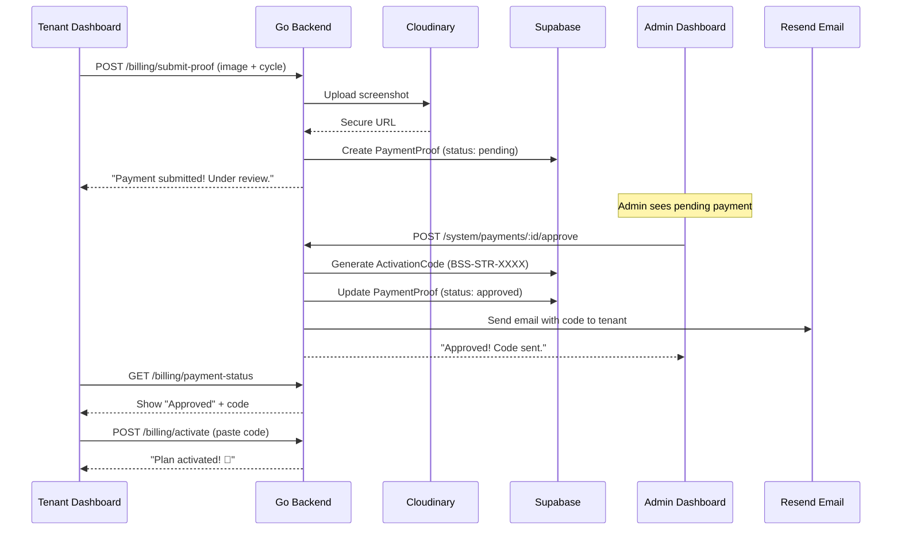

# Manual Payments 2.0 — Automated Bank Transfer Verification

## Problem Statement

Your current payment flow requires manual WhatsApp conversations between you and each customer:
1. Customer sees "How to Subscribe" in the dashboard
2. Customer transfers money to your bank account
3. Customer screenshots the payment and sends it to your WhatsApp
4. **You** manually check the screenshot, then go to the Super Admin panel, create an activation code, copy it, and WhatsApp it back
5. Customer pastes the code into the dashboard

This breaks down at scale. If you have 20 customers paying in the same week, you're spending hours doing manual code generation instead of building product.

## Solution: "Payment Proof Portal"

Automate steps 3–4 entirely. The customer uploads their payment screenshot **directly inside the dashboard**, and you approve it with **one click** in the admin panel — the system generates the code and delivers it automatically.

---

## User Review Required

> [!IMPORTANT]
> **Decision 1: Screenshot Upload Destination**
> We will use your existing **Cloudinary** account (already in `.env`) to store payment screenshots in a `salespilot/payments` folder. This keeps them separate from product images and avoids local file management.

> [!IMPORTANT]
> **Decision 2: Auto-Delivery via Email (not WhatsApp bot)**
> Instead of requiring your platform bot to be connected (which adds fragility), the activation code will be delivered via **Resend email** to the customer's registered email. This is more reliable and creates a paper trail. The admin can still manually send via WhatsApp using the existing "Send" button on the Activation Codes page if preferred.

> [!WARNING]
> **Decision 3: Bank Account Details**
> The current "How to Subscribe" section uses placeholder values (`Commercial Bank of Ceylon`, `1234567890`). You need to provide your real bank details before going live. These are set via environment variables: `NEXT_PUBLIC_BANK_NAME`, `NEXT_PUBLIC_BANK_BRANCH`, `NEXT_PUBLIC_BANK_ACCOUNT_NO`, `NEXT_PUBLIC_BANK_ACCOUNT_NAME`.

---

## Architecture Overview



---

## Proposed Changes

### Component 1: Data Layer

---

#### [NEW] [payment_proof.go](file:///c:/Users/rkksg/Documents/golang-projects/openclaw-sale-agent-bot-whatsapp%20-%20SAAS/models/payment_proof.go)

New model to track payment submissions through their lifecycle.

```go
type PaymentProof struct {
    ID             uint       `json:"id" gorm:"primaryKey"`
    BusinessID     uint       `json:"business_id" gorm:"not null;index"`
    BusinessName   string     `json:"business_name"`           // denormalized for admin list
    BusinessPhone  string     `json:"business_phone"`           // for WhatsApp fallback
    BusinessEmail  string     `json:"business_email"`           // for email delivery
    BillingCycle   string     `json:"billing_cycle" gorm:"not null"` // monthly|quarterly|annual
    Amount         float64    `json:"amount" gorm:"not null"`   // expected LKR amount
    ScreenshotURL  string     `json:"screenshot_url" gorm:"not null"`
    Status         string     `json:"status" gorm:"default:'pending'"` // pending|approved|rejected
    ActivationCode string    `json:"activation_code"`          // filled on approval
    AdminNote      string     `json:"admin_note"`               // reject reason or approval note
    ReviewedAt     *time.Time `json:"reviewed_at"`
    CreatedAt      time.Time  `json:"created_at"`
    UpdatedAt      time.Time  `json:"updated_at"`
}
```

**States:** `pending` → `approved` or `rejected`

#### [MODIFY] [db.go](file:///c:/Users/rkksg/Documents/golang-projects/openclaw-sale-agent-bot-whatsapp%20-%20SAAS/database/db.go)

- Add `&models.PaymentProof{}` to the `AutoMigrate` list (line ~58).

---

### Component 2: Backend Handlers

---

#### [NEW] [payment_proof_handler.go](file:///c:/Users/rkksg/Documents/golang-projects/openclaw-sale-agent-bot-whatsapp%20-%20SAAS/handlers/payment_proof_handler.go)

Five endpoints:

| Endpoint | Auth | Description |
|---|---|---|
| `POST /api/v1/billing/submit-proof` | JWT (tenant) | Upload screenshot + select cycle |
| `GET /api/v1/billing/payment-status` | JWT (tenant) | Check if they have a pending/approved proof |
| `GET /system/payments` | Master Key | List all payment proofs (filterable by status) |
| `POST /system/payments/:id/approve` | Master Key | Approve → auto-generate code → email it |
| `POST /system/payments/:id/reject` | Master Key | Reject with reason |

**Key Logic — `approve` handler:**
1. Fetch the `PaymentProof` record
2. Look up the `Business` by `business_id` to get phone + name
3. Call existing `generateActivationCode(plan)` to create a BSS code
4. Insert a new `ActivationCode` record with `target_phone` locked to the business
5. Update `PaymentProof.Status = "approved"`, `PaymentProof.ActivationCode = code`
6. Send an email via Resend with the code and instructions
7. Log the activity via `LogActivity()`

**Key Logic — `submit-proof` handler:**
1. Receive `multipart/form-data` with `image` file + `billing_cycle` field
2. Validate cycle is valid (`monthly`, `quarterly`, `annual`)
3. Check no existing `pending` proof for this business (prevent spam)
4. Upload image to Cloudinary under `salespilot/payments/proof-{bizID}-{timestamp}`
5. Create `PaymentProof` record
6. Return success

#### [MODIFY] [main.go](file:///c:/Users/rkksg/Documents/golang-projects/openclaw-sale-agent-bot-whatsapp%20-%20SAAS/main.go)

Add new routes:

```go
// Under dash (JWT protected):
dash.POST("/billing/submit-proof", handlers.SubmitPaymentProof)
dash.GET("/billing/payment-status", handlers.GetPaymentStatus)

// Under system (Master Admin):
system.GET("/payments", handlers.ListPaymentProofs)
system.POST("/payments/:id/approve", handlers.ApprovePayment)
system.POST("/payments/:id/reject", handlers.RejectPayment)
```

---

### Component 3: Tenant Dashboard (Frontend)

---

#### [MODIFY] [usage/page.tsx](file:///c:/Users/rkksg/Documents/golang-projects/openclaw-sale-agent-bot-whatsapp%20-%20SAAS/frontend/app/dashboard/usage/page.tsx)

**Changes:**

1. **"Submit Payment Proof" Card** — Replace the current "Send Payment Screenshot on WhatsApp" button with an **in-app upload form**:
   - Billing cycle selector (Monthly / Quarterly / Annual) — auto-fills the expected amount
   - File upload input (accepts images only, max 5MB)
   - Preview of the selected image before submitting
   - Submit button that sends `multipart/form-data` to the backend

2. **"Payment Under Review" Banner** — When a pending proof exists, show a prominent amber banner:
   > "Your payment proof is being verified. You'll receive your activation code via email shortly."
   - Shows the timestamp of submission
   - Shows the selected plan/cycle

3. **"Payment Approved" Banner** — When proof is approved, show a green banner with the code pre-filled in the activation input:
   > "Your payment has been verified! ✅ Your activation code: BSS-STR-XXXX"
   - Auto-populates the activation code input field below

4. **Keep the existing WhatsApp link** as a fallback, but move it below the upload form as secondary option:
   > "Prefer WhatsApp? [Send payment screenshot on WhatsApp →]"

---

### Component 4: Admin Dashboard

---

#### [NEW] [payments/page.tsx](file:///c:/Users/rkksg/Documents/golang-projects/openclaw-sale-agent-bot-whatsapp%20-%20SAAS/admin-frontend/src/app/(admin)/payments/page.tsx)

A new **Payment Verification Queue** page in the admin dashboard.

**Layout:**
- Stats bar: Pending | Approved Today | Total Revenue
- Filter tabs: All / Pending / Approved / Rejected
- Table with columns: Business Name | Phone | Cycle | Amount | Screenshot | Submitted | Actions

**Screenshot Preview:**
- Thumbnail in the table row
- Click to open full-size in a modal overlay (lightbox)

**Actions:**
- **Approve** (green button): Opens a confirmation modal → triggers backend → shows toast "Code BSS-XXX-XXXX sent to [email]"
- **Reject** (red button): Opens a modal with a reason text field → triggers backend → shows toast "Payment rejected"

**Design:** Match the existing admin dashboard aesthetic (indigo accent, dark surfaces, same component patterns as [activation-codes/page.tsx](file:///c:/Users/rkksg/Documents/golang-projects/openclaw-sale-agent-bot-whatsapp%20-%20SAAS/admin-frontend/src/app/(admin)/activation-codes/page.tsx)).

#### [MODIFY] [admin layout.tsx](file:///c:/Users/rkksg/Documents/golang-projects/openclaw-sale-agent-bot-whatsapp%20-%20SAAS/admin-frontend/src/app/(admin)/layout.tsx)

Add the "Payments" nav item to the sidebar between "Activation Codes" and "Audit Logs":

```typescript
{ href: "/payments", label: "Payments", icon: Banknote, section: "main" },
```

Include a **badge** showing the count of pending payments (fetch on mount, refresh periodically).

---

### Component 5: Email Notification

---

#### [MODIFY] [email.go](file:///c:/Users/rkksg/Documents/golang-projects/openclaw-sale-agent-bot-whatsapp%20-%20SAAS/utils/email.go)

Add a new function `SendActivationCodeEmail(toEmail, businessName, code, plan, cycle, durationDays string) error` that sends a professional HTML email via Resend:

**Email Subject:** `Your SalesPilot activation code is ready! 🎉`

**Email Body:**
> Hi **[Business Name]**,
>
> Your payment has been verified. Here is your activation code:
>
> **BSS-STR-XXXX**
>
> **Plan:** Starter | **Duration:** 90 days
>
> **How to activate:**
> 1. Login to your SalesPilot dashboard
> 2. Go to Usage & Plan
> 3. Paste the code in the "Enter Activation Code" box
>
> Need help? Reply to this email or WhatsApp us at +94XXXXXXXXX.

---

## My Suggestions (Bonus Improvements)

### 💡 Suggestion 1: Duplicate Payment Prevention
Block a tenant from submitting a new payment proof while they already have one in `pending` status. This prevents confused users from uploading 3 screenshots of the same transfer.

### 💡 Suggestion 2: Admin Notification Count Badge
Show a red dot or count badge on the "Payments" nav item in the admin sidebar when there are pending approvals. This ensures you never miss a payment.

### 💡 Suggestion 3: Auto-Copy Code for Approved Payments
When the tenant's payment is approved and they visit the Usage page, auto-fill their activation code input with the generated code. One click to activate — zero friction.

### 💡 Suggestion 4: Payment History for Tenants
Add a small "Payment History" section at the bottom of the Usage page showing past submissions with their status (pending/approved/rejected). This gives transparency and reduces support inquiries.

### 💡 Suggestion 5: Revenue Tracking for Admin
The existing `/revenue` admin page can be enhanced to pull from `PaymentProof` records where `status = 'approved'`. This gives you automatic revenue tracking without manual spreadsheets.

---

## Open Questions

> [!IMPORTANT]
> **Q1:** Do you want the activation code to be **auto-redeemed** on approval (skipping the paste step entirely), or do you prefer the current flow where the customer pastes the code themselves? Auto-redeem is faster but gives the customer less control.

> [!IMPORTANT]
> **Q2:** Should rejected payments show a reason to the tenant (e.g., "Screenshot unclear, please resubmit"), or should we just show a generic "Payment could not be verified" message?

---

## Verification Plan

### Automated Tests
- `go run main.go` — confirm server starts without migration errors
- Test the upload endpoint with `curl` to verify Cloudinary integration

### Manual Verification
1. **Tenant Side:** Upload a dummy screenshot in the dashboard for "Quarterly" plan
2. **Admin Side:** See the pending payment in the admin queue, click Approve
3. **Email:** Verify the activation code email arrives at the registered email
4. **Tenant Side:** Check that the code appears on the Usage page, paste it, and verify the plan upgrades

### Edge Cases to Test
- Submit proof while one is already pending → should be blocked
- Approve a proof for a business that's already on a paid plan → should stack duration
- Reject a proof → tenant should see rejection message
- Upload a non-image file → should be rejected by the backend
