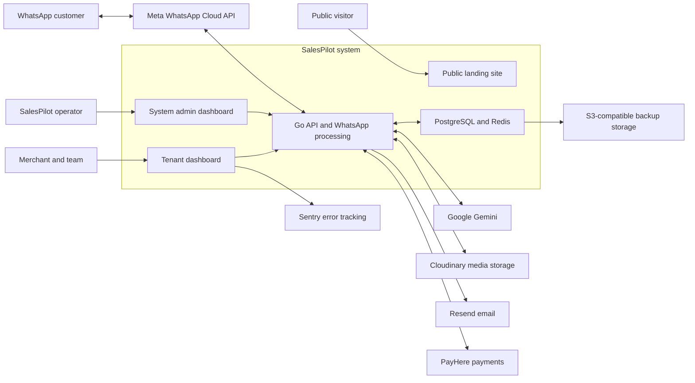
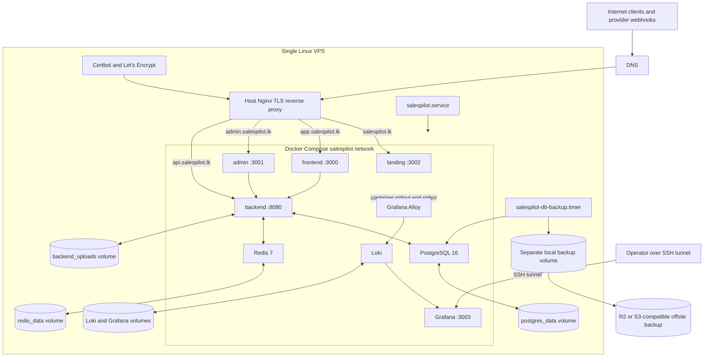
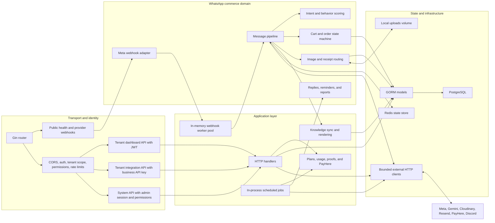
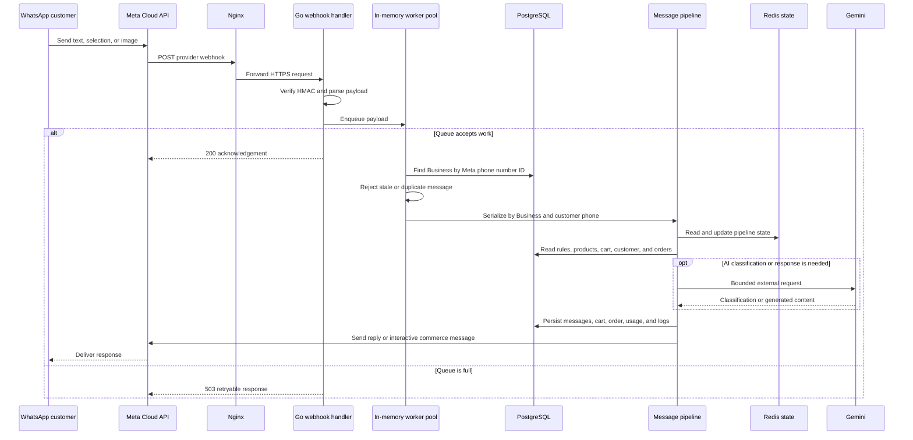
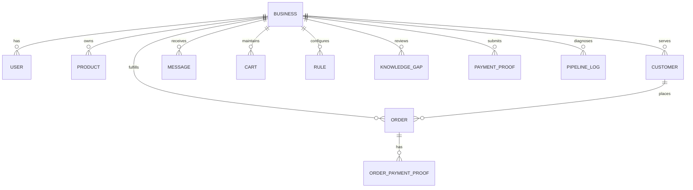

# SalesPilot Architecture

This document describes the architecture implemented in this repository and the
default single-VPS production target. It does not describe future mobile or
multi-region plans. Last verified: 2026-06-21.

## System Context



SalesPilot is a multi-tenant WhatsApp commerce platform. A `Business` is the
tenant root. Its products, customers, conversations, carts, orders, rules,
usage, and payment proofs are isolated by `business_id`.

## Production Deployment



Only Nginx ports `80` and `443` should be publicly reachable. Compose publishes
the four web services, Grafana, and Alloy to `127.0.0.1` only. PostgreSQL, Redis,
Loki, and the Docker network have no public host ports.

### Runtime Inventory

| Runtime | Responsibility | Exposure | Persistent state |
| --- | --- | --- | --- |
| Host Nginx | TLS termination, HTTP redirect, security headers, routing | Public `80/443` | Let's Encrypt certificates on the host |
| `landing` | Public Next.js site | Loopback `3002` through Nginx | None |
| `frontend` | Merchant Next.js dashboard | Loopback `3000` through Nginx | Browser state; no server database |
| `admin` | System operator Next.js dashboard | Loopback `3001` through Nginx | Browser state; no server database |
| `backend` | Gin API, webhooks, worker pool, cron jobs, integrations | Loopback `8080` through Nginx | Upload and data volumes; canonical records are in PostgreSQL |
| `postgres` | Canonical transactional and tenant data | Compose network only | `postgres_data` |
| `redis` | Shared pipeline state, budgets, and short-lived behavior state | Compose network only | `redis_data` with AOF enabled |
| `alloy` | Reads Docker logs and sends them to Loki | Loopback diagnostics port `12345` | `alloy_data` |
| `loki` | Aggregated log storage | Compose network only | `loki_data` |
| `grafana` | Log exploration | Loopback `3003`, SSH tunnel only | `grafana_data` |
| Backup timer/service | Encrypted `pg_dump`, verification, retention, offsite upload | Host systemd only | Separate local volume plus offsite objects |

## Backend Components



### Package Map

| Path | Architectural responsibility |
| --- | --- |
| `backend/main.go` | Composition root: configuration, database, state store, worker pool, routes, cron startup, and graceful shutdown |
| `backend/config` | Environment loading and critical configuration validation |
| `backend/middleware` | JWT, tenant API key, super-admin session and permission checks, tenant-scoped DB injection, rate limits |
| `backend/handlers` | Dashboard, integration, billing, and system-admin HTTP use cases |
| `backend/whatsapp` | Meta webhook adapter, message pipeline, scoring, FAQ/intent routing, carts, orders, media, and outbound WhatsApp calls |
| `backend/services` | Scheduled plan, cart, delivery, payment cleanup, and monthly-report jobs |
| `backend/knowledge` | System knowledge synchronization and prompt-ready rendering |
| `backend/platform` | Platform-owned billing catalog behavior |
| `backend/models` | GORM persistence models and domain constants |
| `backend/database` | PostgreSQL connection, versioned schema migrations, indexes, and seed/bootstrap behavior |
| `backend/cache` | Memory/Redis `StateStore` abstraction for shared pipeline state |
| `backend/httpclient` | Dependency budgets, safe retries, circuit breakers, and classified external request errors |
| `backend/observability` | JSON logging, request correlation, redaction, and the error-reporter interface |
| `backend/errorreporting` | Bounded, deduplicated operational error reporting to Discord |
| `backend/utils` | JWT, email, alerting, phone normalization, and the fixed webhook worker pool |
| `frontend` | Merchant dashboard for products, rules, chats, orders, finance, settings, and billing |
| `salespilot-admin-main` | System dashboard for businesses, plans, activation, payments, notices, and audit operations |
| `landing` | Public marketing and legal site |
| `deploy` | Nginx, systemd, backup, deployment, and observability configuration |

## WhatsApp Commerce Flow



Important behavior:

- The webhook acknowledges Meta only after work enters the worker queue.
- The queue, five-minute webhook deduplication map, and per-customer mutexes are
  in backend memory; they are not a durable message broker.
- Redis stores shared scoring, budget, and first-message state, but PostgreSQL is
  the canonical business record.
- Text and interactive messages enter the main pipeline. Images route through
  media classification and may use Gemini and Cloudinary.
- Each tenant is selected by Meta phone number ID before processing starts.

## Data Ownership



This is a logical ownership view, not an exact foreign-key map. For example,
orders identify customers by tenant and phone, order items are serialized in the
order record, and platform-global rules may have no `business_id`.

`Business` is the tenancy boundary. Most tenant records carry `business_id` and
dashboard middleware injects a scoped GORM handle. Handlers must still use that
scoped handle or include an explicit tenant filter. System-admin operations use
separate authorization and permission checks because they intentionally cross
tenant boundaries.

Tenant Meta access tokens are currently stored on `Business` records. The
security audit tracks application-level encryption as an open production gate.

## Entry Points And Trust Boundaries

| Entry point | Authentication or verification | Tenant selection |
| --- | --- | --- |
| `GET /health` | Public | None; includes PostgreSQL ping |
| `GET/POST /api/whatsapp/webhook` | Meta verify token for setup; HMAC signature for delivery | Meta phone number ID maps to `Business` |
| `/api/v1/auth/*` | Public with rate limits | Registration/login input |
| `/api/v1/*` | JWT plus active user/session checks | JWT `business_id`; scoped DB is injected |
| `/api/*` | Tenant API key with rate limit | API key maps to `Business`; scoped DB is injected |
| `/system/auth/*` | Rate-limited admin login | Platform scope |
| `/system/*` | Hashed admin bearer session plus role permission | Cross-tenant platform scope |
| `POST /api/v1/billing/notify` | PayHere signature | Payment attempt/order identifier |
| `/uploads/*` | Public static files | Path only; review privacy before storing sensitive media locally |

Nginx is the network trust boundary. The backend trusts proxy headers only from
loopback. The application trust boundary then depends on the route-specific
middleware above. See `docs/security-audit-owasp-top-10.md` for open risks.

## Scheduled Work

Cron jobs run as goroutines inside the backend process:

| Frequency | Work |
| --- | --- |
| Startup and hourly | Expired plan and trial checks |
| Every 2 hours | Abandoned-cart reminders |
| Every 6 hours | Late-delivery alerts |
| Startup and every 6 hours | Cancel stale unpaid bank-transfer orders |
| Daily at 06:00, active on day 1 | Monthly intelligence reports |

The schedule uses the backend container's local timezone. Production should set
and verify the intended timezone explicitly before relying on wall-clock jobs.

## Observability And Recovery

- Containers write structured-enough text logs to stdout and stderr.
- Docker keeps bounded local JSON logs; Alloy forwards them to Loki.
- Grafana reads Loki and is available only through an SSH tunnel.
- Sentry covers the tenant frontend when enabled.
- Discord webhooks carry selected backend operational alerts.
- `/health` checks both the API process and PostgreSQL connectivity.
- Daily encrypted PostgreSQL backups go to a separate local volume and,
  optionally, S3-compatible offsite storage.
- Loki, Grafana, Redis, and uploads are not included in the PostgreSQL backup.
  Rebuild or separately preserve them according to business need.

Operational procedures live in:

- `docs/on-call-rotation.md`
- `docs/incident-response-playbook.md`
- `docs/log-aggregation.md`
- `docs/database-backups.md`
- `docs/disaster-recovery.md`

## Current Constraints

These are architectural boundaries, not hidden assumptions:

1. The production design runs one backend replica. The worker queue,
   deduplication map, customer locks, and cron ownership are process-local.
2. Adding backend replicas requires a durable queue, distributed idempotency,
   distributed per-customer ordering, and single-owner or locked scheduled jobs.
3. PostgreSQL is a single instance on the same VPS by default. Offsite backups,
   not local replication, are the present total-VPS-loss recovery mechanism.
4. Redis pipeline state and observability data live on the same VPS. Their
   failure must not be mistaken for loss of canonical order data.
5. Local uploads are served directly by the backend. Sensitive payment proofs
   should move to private object storage with authorized access.
6. The three Next.js apps receive public URLs at image build time and must be
   rebuilt when `NEXT_PUBLIC_*` values change.
7. Production database startup verifies `schema_migrations` instead of mutating
   schema. Reviewed migrations run through `salespilot-migrate` before backend
   startup.
8. Tenant isolation depends on `business_id` scoping. New data access paths need
   explicit tenant-isolation tests.

## Diagram Maintenance

Update this document in the same change when any of these move:

- services, ports, volumes, or networks in `docker-compose.prod.yml`;
- host routing or domains in `deploy/nginx/salespilot.ssl.conf`;
- route groups or startup jobs in `backend/main.go`;
- webhook queue or pipeline behavior in `backend/whatsapp`;
- tenancy ownership in `backend/models` or `backend/middleware`;
- backup, observability, or systemd topology under `deploy`.

During review, render all Mermaid blocks and compare the runtime diagram with:

```bash
docker compose --env-file .env.production -f docker-compose.prod.yml config
docker compose --env-file .env.production -f docker-compose.prod.yml ps
```
