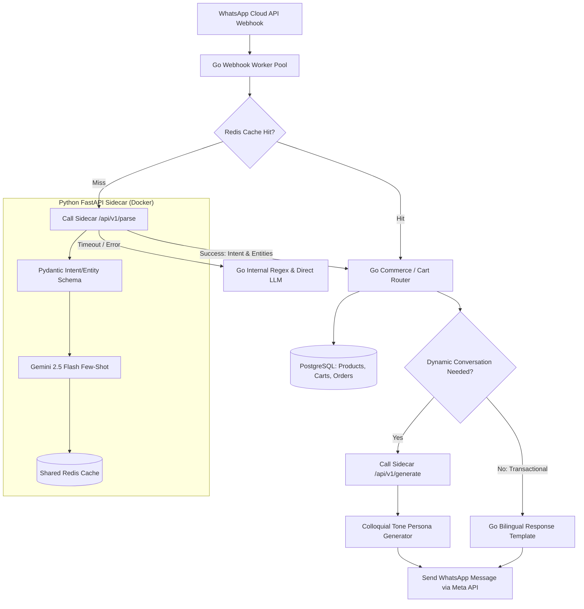

# Sinhala & Singlish AI Microservice Architecture for SalesPilotLK

## 1. Executive Summary & Design Vision

In **SalesPilotLK**, customer communication over WhatsApp in Sri Lanka is heavily colloquial, dominated by:
1. **Phonetic Singlish** with arbitrary spellings (e.g., *keeyada*, *kiyada*, *thiyeda*, *thiyenawada*, *gana keeyada*, *salli kohomada*).
2. **Colloquial Spoken Sinhala** (*කටවහර / කතා බහ*) rather than formal written/book Sinhala (*පොත් බස*).
3. **Mixed Code-Switching** (e.g., *"bro black colour eken M size ekak thiyenawada delivery Colombo 03 walata"*).

The current Go pipeline relies on hardcoded regex in [`normalize.go`](file:///home/kith/projects/web-apps/salespilot/backend/whatsapp/normalize.go) and small static word maps. When these rules fail, messages bypass deterministic paths and trigger unconditioned LLM fallbacks, leading to high latency, increased token consumption, and stiff/robotic literary responses.

By introducing a **dedicated Python FastAPI AI Sidecar (`salespilot-ai-sidecar`)** alongside the Go backend, we turn this bottleneck into a **market differentiator**:
- **Structured Understanding**: Instant parsing of messy Singlish and Sinhala into structured intents and entities.
- **Natural Colloquial Persona**: Generating friendly, natural WhatsApp-style responses mirroring the customer's language and tone.
- **High Performance & Resilience**: Sub-millisecond Redis caching for high-frequency phrases with a circuit-breaker fallback to Go's internal pipeline.

---

## 2. System Architecture & Topology



---

## 3. Python Sidecar API Specification

The sidecar is a lightweight FastAPI application using `pydantic` and `google-genai` / `redis`.

### 3.1. `POST /api/v1/parse`

Extracts structured intent, entities, and dialect from customer messages.

#### Request:
```json
{
  "message": "bro black colour eken M size ekak thiyenawada delivery colombo 3 walata",
  "business_id": "biz_123",
  "customer_phone": "+94771234567"
}
```

#### Response:
```json
{
  "intent": "check_stock_and_delivery",
  "confidence": 0.98,
  "detected_dialect": "singlish",
  "language_code": "si-en",
  "entities": {
    "product_name": null,
    "attributes": {
      "color": "black",
      "size": "M"
    },
    "location": "Colombo 03",
    "delivery_inquiry": true,
    "quantity": 1
  },
  "is_greeting": false,
  "cached": false
}
```

### 3.2. `POST /api/v1/generate`

Generates natural, dialect-aware colloquial customer responses.

#### Request:
```json
{
  "business_name": "UrbanTrend LK",
  "customer_dialect": "singlish",
  "tone_policy": "friendly_colloquial",
  "context": {
    "product_name": "Linen Casual Shirt - Black",
    "is_available": true,
    "available_sizes": ["M", "L", "XL"],
    "price_lkr": 3500,
    "delivery_cost_lkr": 350,
    "estimated_days": "1-2 days to Colombo 3"
  },
  "customer_query": "bro black colour eken M size ekak thiyenawada delivery colombo 3 walata"
}
```

#### Response:
```json
{
  "reply": "Ow machan, Black M size eka stock thiyenawa! Price eka Rs. 3,500/=, Colombo 3 walata delivery Rs. 350/= (1-2 days yanne). Order eka daamu da?",
  "dialect": "singlish",
  "suggested_actions": ["confirm_order", "view_details"]
}
```

---

## 4. Prompt Engineering for Natural Colloquial Sinhala & Singlish

The key failure in existing bots is translating into formal "Book Sinhala" (*රාජකාරී භාෂාව*):
- ❌ **Formal / Unnatural**: *"ඔබට සුභ දවසක් වේවා. කළු පැහැති ප්‍රමාණයේ ඇඳුම තොගයේ ඇත. ඔබ එය මිලදී ගැනීමට කැමතිද?"*
- ✅ **Conversational Spoken Sinhala**: *"ඔව් මචං/අයියා, Black M size එක stock තියෙනවා! ගාණ Rs. 3,500/= යි. Colombo 3 වලට දවස් 1-2න් deliver කරන්න පුළුවන්. Order එක දාන්නද?"*
- ✅ **Conversational Singlish**: *"Ow aiyya, Black M size thiyenawa. Colombo 3 walata delivery ekath ekka Rs. 3,850/= wenne. Address eka ewanna order eka confirm karanna!"*

The sidecar system prompt enforces:
1. **Mirroring**: If the customer texts in Singlish, reply in friendly Singlish. If they write in Sinhala Unicode script, reply in natural spoken Sinhala script (*කතා බහ ශෛලිය*).
2. **Honorific Calibration**: Respectful Sri Lankan commercial terms (*"Aiyya", "Machan", "Madam/Sir"* based on store profile).
3. **Commercial Brevity**: Short, WhatsApp-optimized sentences with prices formatted as standard Sri Lankan currency notations (`Rs. 3,500/=` or `LKR 3,500`).

---

## 5. Go Backend Integration Architecture

### 5.1. Sidecar Client Package (`backend/nlp/client.go`)
Create an HTTP client in Go with:
- **Strict Timeout**: 800ms context timeout.
- **Circuit Breaker**: If 3 consecutive calls fail or time out, trip the circuit for 30 seconds and fall back immediately to local [`normalize.go`](file:///home/kith/projects/web-apps/salespilot/backend/whatsapp/normalize.go).
- **Asynchronous Health Checks**: Ping `/healthz` periodically.

### 5.2. Pipeline Integration (`backend/whatsapp/pipeline.go`)
Modify the message evaluation order:
1. **Pass 1**: Extract Intent & Entities via Sidecar `/parse` (or cached Redis entry).
2. **Pass 2**:
   - If structured intent matches a product or cart action, execute cart updates in PostgreSQL immediately without calling LLM for text.
   - If an explanation or FAQ response is needed, format context and call `/generate`.
3. **Fallback**: If Sidecar fails or returns low confidence (<0.6), seamlessly continue to existing deterministic rule evaluation and Gemini Flash fallback.

---

## 6. Docker & Infrastructure Deployment

In both [`docker-compose.local.yml`](file:///home/kith/projects/web-apps/salespilot/docker-compose.local.yml) and [`docker-compose.prod.yml`](file:///home/kith/projects/web-apps/salespilot/docker-compose.prod.yml):

```yaml
  sinhala-nlp:
    build:
      context: ./services/sinhala-nlp
      dockerfile: Dockerfile
    container_name: salespilot-sinhala-nlp
    restart: unless-stopped
    environment:
      - PORT=8000
      - GEMINI_API_KEY=${GEMINI_API_KEY}
      - REDIS_URL=redis://redis:6379/1
    networks:
      - internal_network
    deploy:
      resources:
        limits:
          memory: 350M
          cpus: '0.5'
```

- Accessible internally by the backend at `http://sinhala-nlp:8000`.
- No public ports exposed to Nginx or the Internet.
- Bounded memory footprint (350MB limit) prevents VPS RAM exhaustion.

---

## 7. Phased Implementation Roadmap

| Phase | Milestone | Deliverables |
|---|---|---|
| **Phase 1: Sidecar Foundation** | Service Scaffold & Schemas | FastAPI project under `services/sinhala-nlp`, Pydantic models for Singlish/Sinhala intents & entities, Dockerfile, Redis client. |
| **Phase 2: Intent & Entity Parsing** | `/api/v1/parse` Endpoint | Few-shot prompt engineering with Gemini 2.5 Flash, structured JSON parsing, Redis response caching. |
| **Phase 3: Natural Colloquial Generation** | `/api/v1/generate` Endpoint | Sri Lankan conversational tone calibration (friendly Singlish & spoken Sinhala script), store context injection. |
| **Phase 4: Go Backend Integration** | Client & Circuit Breaker | Go HTTP client in `backend/whatsapp/`, pipeline wiring in `pipeline.go`, timeout fallback to `normalize.go`. |
| **Phase 5: Local Testing & Validation** | End-to-End Test Suite | Unit tests with 100+ real-world Sri Lankan customer Singlish messages, benchmark latency (<150ms). |
